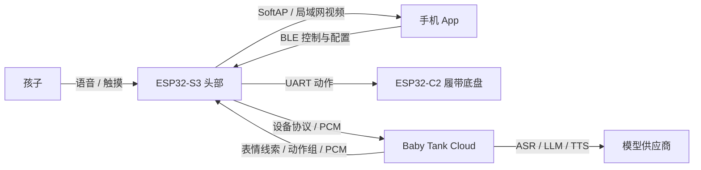

<div align="center">
  
  <h1>Baby Tank</h1>
  <p><strong>一个会说话、会表达、会开车，也会犯困的机器人宝宝。</strong></p>
  <p>
    
    
    
    
  </p>
  <p>
    <a href="#玩法">玩法</a> ·
    <a href="#系统架构">架构</a> ·
    <a href="#项目分类">项目分类</a> ·
    <a href="#快速开始">快速开始</a> ·
    <a href="docs/README.md">完整文档</a>
  </p>
</div>

Baby Tank 是一个面向儿童的可移动桌面宠物。它有自己的表情、心情和作息，可以通过语音、触摸和手机互动，也能观察环境、控制履带底盘并玩小游戏。

这不是给 ESP-SparkBot 示例换皮。项目只参考其硬件资料、引脚和底盘协议，正式固件、Android App、云端编排、角色状态和视觉系统均在本仓库重新实现。

> [!IMPORTANT]
> 当前处于功能集成与实机验证阶段，还不是经过儿童安全、续航、跌落、EMC、隐私和量产安全认证的成品。

## 项目速览

| 有生命感的屏幕 | 自然的 AI 对话 | 可移动、可观察 | 孩子看图就能玩 |
| --- | --- | --- | --- |
| 53 种表达状态，慢心情、短情绪、正常/无聊/睡觉三态 | 本地唤醒，云端 ASR/LLM/TTS，表情与语音同步 | BLE 遥控、AI 动作组、SoftAP/LAN 摄像头 | 喂食、戳一戳、石头剪刀布、连点比赛、摇骰子 |

## 产品定位

Baby Tank 的角色不是“带轮子的语音助手”，而是一个会主动表达的小宝宝：

- **先有生命感，再有功能感**：屏幕主要展示眼睛、嘴巴和漫画元素，不把设备做成信息面板。
- **孩子看图就能玩**：主要操作依靠图形、颜色、动画和声音；文字保留给家长和无障碍语义，不作为儿童唯一线索。
- **允许安静存在**：正常、无聊、睡觉是连续状态，不要求孩子不断下命令。
- **AI 负责理解和选择，固件负责安全执行**：模型可以决定说什么、呈现什么心情、是否观察或移动，但不能直接控制像素、任意串口字节或无限时长动作。
- **没有互联网仍可玩**：触摸反馈、表情、固定语音、小游戏和 BLE 遥控尽量本地完成；云端只承担确实需要模型的能力。

## 系统架构



计算任务按设备能力分配：

| 层级 | 主要职责 | 不应该承担 |
| --- | --- | --- |
| ESP32-S3 头部 | 触摸、WakeNet、麦克风、扬声器、屏幕动画、摄像头、BLE/Wi-Fi、底盘安全执行 | 保存云厂商长期密钥、执行任意模型代码 |
| ESP32-C2 底盘 | 电机和灯光的确定性执行、失联停车 | AI 推理、视频和复杂业务状态 |
| Android App | 儿童 UI、遥控、配网、视频解码、本地游戏动画和音效 | 传输摄像头视频到 BLE、保存云厂商密钥 |
| Baby Tank Cloud | 设备身份、ASR/LLM/TTS 编排、心情与短期记忆、OTA、管理页面 | 绕过设备安全边界直接驱动硬件 |

### 通信分类

- **BLE**：配网、遥控、灯光、音量、表情、测试命令和低频状态。
- **局域网 / SoftAP**：摄像头 MJPEG 等大数据；视频不走 BLE。
- **互联网**：ASR、LLM、TTS、云端心情和偶尔更新的梦境短句。
- **UART**：头部到履带底盘的运动和灯光命令。

## 项目分类

### 1. 头部固件

目录：[`firmware/head/`](firmware/head/)

- 当前源码版本 `0.14.28`，目标为 ESP32-S3、16 MiB Flash、8 MiB PSRAM。
- 240×240 ST7789 漫画脸、50 余种表达状态和本地动画。
- “喵喵同学” WakeNet 本地唤醒、触摸唤醒与再次触摸退出对话。
- 16 kHz、16-bit、单声道 PCM 的录音、流式上传和播放。
- BLE 配网与控制、Wi-Fi/SoftAP、摄像头 MJPEG、UART 底盘桥接。
- 遥控租约、STOP 抢占、命令过期和 AI 动作组。

### 2. Android App

目录：[`android/`](android/)

- Kotlin + Jetpack Compose，目标 Android 8.0 及以上。
- 首页只保留主要入口，复杂配置和硬件测试进入二级设置页。
- 横屏遥控：中间视频、左侧方向控制、右侧灯光/声音/开炮等功能。
- 加密 BLE 配网和控制、机器人 WPA2 SoftAP 视频、速度和音量设置；家庭 Wi-Fi 密码在手机填写，也支持明确选择开放网络。
- 喂食、戳一戳及三种本地小游戏；喂食时手机只显示阻挡式状态弹框，完整进食演出由机器人屏幕承担。

### 3. 云端与管理页

目录：[`src/`](src/)、[`public/`](public/)、[`test/`](test/)

- Node.js 24 单进程服务和 SQLite 数据库。
- 单管理员、设备登记、可撤销设备令牌、OTA 和审计记录。
- OpenAI 兼容 LLM、阿里百炼 Paraformer ASR、火山 Seed-TTS 适配。
- 每台设备的加密对话上下文、慢心情状态、表情时间线和动作提案。
- 云厂商凭据使用服务端主密钥加密，不下发到机器人或 App。

### 4. 文档、工具与模型

- [`docs/`](docs/)：架构、协议、功能设计和每日硬件联调记录。
- [`tools/`](tools/)：凭据镜像、字库、TTS 音频和图像转换工具。
- [`ml/wakeword/`](ml/wakeword/)：本地唤醒词路线与实验记录。
- [`agent-readme.md`](agent-readme.md)：硬件事实、上游边界、风险和长期开发上下文。

本地工具链、上游参考仓库、设备 Flash 备份、APK、构建目录、真实 `sdkconfig` 和凭据被 `.gitignore` 排除。

## 核心设计思路

### 稳定形象，参数化表演

角色基础形象固定为黑底、青色眼睛和暖色嘴巴。不同心情不重新生成一张脸，而是在统一比例上改变眼形、嘴形、位移、节奏和少量漫画符号。这样能避免动画切换时“换了一个角色”。

表情动画遵循“预备 → 动作 → 轻微过冲 → 稳定 → 回归”，并加入不完全同步的眨眼、视线漂移和呼吸感。AI 只能提交白名单中的语义标签、强度和时长，不能直接画屏幕。

### 慢心情、快情绪、设备状态分层

- **Mood**：云端保存的慢状态，由愉悦度、活跃度和掌控感组成，会随时间回归温和基线。
- **Emotion**：每句回复或事件带来的短时表情脉冲，例如开心、委屈、好奇或生气。
- **Presence**：设备当前处于正常、无聊或睡觉，优先级高于心情。

没有事件时，正常状态保持 60 秒，再进入 30 秒无聊状态，之后进入睡觉。触摸、语音或 App 交互会重新回到正常状态；普通网络刷新不能把睡眠错误唤醒。

### 手机、固件和云端各做擅长的事

- 手机负责丰富图片、高帧率动画、游戏规则和音效。
- 固件负责低延迟表情、固定 TTS、传感器和安全动作。
- 云端负责语言理解、角色连续性、心情计算和供应商适配。

BLE 只下发动作结果，不传动画帧；摇骰子等过程由两端根据同一个最终结果各自在本地演出。

### AI 动作组，而不是“说完再动”

一轮 AI 回复可以同时包含 TTS、表情、灯光、画面、摄像头观察和有限时长的底盘动作。播放开始时各通道按时间线并行执行，手机遥控、急停或失联会立即抢占旧动作。

模型可以主动判断是否需要移动，不要求孩子说出机械的“前进”命令；但单次时长、速度范围、STOP、遥控优先级和失联停车属于不可取消的物理安全边界。

### 睡觉不是黑屏

睡眠保持闭眼、呼吸、鼻涕泡或嘴边口水等轻微漫画动作。`Z` 从同一个起点依次向右上漂移，最后一个变为梦境云朵，展示云端偶尔更新的短句，再缩回 `Z`。睡眠期间隐藏联网文字，仅在需要关注时以小图标显示异常或低电量。

## 玩法

<p align="center">
  
</p>

手机端以图形作为主要操作线索。上图是当前游戏、食物、饮品和胜负反馈的统一软陶绘本风资产；文字只作为家长和无障碍辅助。

### 陪伴与对话

- 说“喵喵同学”或触摸顶部开始对话。
- 再次触摸可取消聆听、思考或播放，避免只能等待一轮结束。
- 聆听使用耳朵感表情，思考使用右上角轻量 loading，回复时嘴形跟随实际 PCM 音量。
- 左右侧触摸会让眼睛明显看向对应方向，并触发与当前心情相关的反馈。

### 观察和自主行动

- AI 可以根据对话和已经获取的画面决定是否观察、亮灯、改变表情或短距离移动。
- 摄像头画面可参与判断，但拍照、绘画、睡眠和触摸回合不会同时授权移动。
- 绘画只使用服务端白名单 SVG 版式，不允许模型直接下发任意 SVG 或像素数据。

### 手机遥控车

- 进入遥控页后，机器人播报“已进入遥控模式”，暂停 WakeNet、AI 对话和自主移动。
- 横屏显示摄像头；方向键按住连续行驶，松手立即 STOP。
- 可调整速度、切换灯光、鸣笛、播放短语和“开炮”。开炮时机器人同步播放声音和屏幕爆炸动画。
- 离开页面、App 异常停止或 BLE 断开后，遥控租约过期并恢复 AI 唤醒。

### 戳一戳

手机只保留一个大图按钮。每次点击随机触发害羞、惊讶、大笑或不耐烦等反应，设备同步播放对应表情。

### 喂东西

食物和饮品使用独立图片按钮，包括草莓、苹果、香蕉、蛋糕、饼干、面包、饭团、冰淇淋、牛奶、果汁、水、酸奶、豆浆和热可可。点击后，设备展示相应食物靠近嘴巴的进食或饮用动画。

### 石头剪刀布

孩子点击石头、剪刀或布的图片，手机和机器人同时出手。机器人屏幕先完整展示大手势，再揭晓输赢并播放“我赢了”“我输了”或“平局啦”。

### 连点比赛

五秒内快速点击拳套按钮，与宝宝比较次数。手机负责计时、震撼感动画、音效和明显的胜负结果；机器人显示连续出拳及最终表情。

### 摇骰子

手机和机器人同时播放滚动动画后各停在 1–6 点，直接比较大小，不要求孩子阅读或输入数字。

## 当前验证状态

| 部分 | 已确认 | 仍需验证 |
| --- | --- | --- |
| 云端 | `npm test` 14/14、语法检查通过 | 真实供应商长期稳定性、并发与故障恢复 |
| 固件 | 0.14.28 已构建并烧录；启动日志确认显示、音频、WakeNet、触摸和 BLE/Wi-Fi 初始化 | 进食动画人工观感、低电量并发、长时间运行、量产安全配置 |
| 底盘 | 前进、后退、左转、右转基础动作实机确认 | 直行偏差标定、满速负载、独立失联停车 |
| Android | Debug APK 构建通过；BLE、遥控和交互流程已实现 | 当前生图 UI 的完整真机视觉回归；项目暂无 Android 单元测试源码 |
| 摄像头 | 固件流与 App 客户端已实现 | 不同手机/网络组合下的帧率、延迟和重连稳定性 |

“源码存在”或“构建通过”不等于整机验收通过。每项实机结论和遗留问题记录在 [`docs/bringup/`](docs/bringup/) 中。

## 路线图

- [x] 独立 ESP32-S3 固件、屏幕和基础角色形象
- [x] WakeNet、触摸唤醒、流式 PCM 对话和语音驱动嘴形
- [x] BLE 配网与控制、UART 底盘桥接、遥控租约和急停抢占
- [x] 心情系统、正常/无聊/睡觉状态和梦境动画
- [x] Android 横屏遥控、摄像头、喂食和三种小游戏
- [ ] Android 真机视觉回归与自动化界面测试
- [ ] 摄像头在不同手机和网络下的帧率、延迟与重连基准
- [ ] 底盘直行标定、满速负载和独立失联停车验证
- [ ] Secure Boot、Flash/NVS Encryption 和正式密钥轮换
- [ ] 儿童使用场景的机械、电池、隐私和家长控制验收

## 快速开始

### 云端

要求 Node.js 24 或更高版本：

```bash
cp .env.example .env
openssl rand -base64 32
set -a
source .env
set +a
npm install
npm test
npm run check
npm start
```

首次启动必须设置至少 12 位的 `ADMIN_PASSWORD`，并为 `MASTER_KEY` 使用独立随机值。本地 HTTP 调试可设置 `COOKIE_SECURE=false`；公网部署必须恢复安全 Cookie 并使用 HTTPS。

### Android

```bash
cd android
./gradlew :app:assembleDebug
```

本地 Android SDK 路径写入不提交的 `android/local.properties`。APK 输出到 `android/app/build/outputs/apk/debug/app-debug.apk`。

### ESP32-S3 固件

使用 ESP-IDF 6.1：

```bash
. .tools/esp-idf-v6.1/export.sh
idf.py -C firmware/head set-target esp32s3
idf.py -C firmware/head build
```

依赖版本由 `firmware/head/dependencies.lock` 固定。烧录前必须确认硬件版本、Flash/PSRAM 配置和原始 Flash 备份，不要因为另一块板子也是 ESP32-S3 就直接烧录。

## 文档导航

完整索引见 [`docs/README.md`](docs/README.md)。推荐从以下内容开始：

- [系统架构与信任边界](docs/architecture.md)
- [设备 API](docs/device-api.md)
- [硬件事实、上游边界与长期记录](agent-readme.md)
- [AI 对话、表情与动作桥接](docs/bringup/2026-10-16-ai-dialogue-expression-bridge.md)
- [心情、睡眠与触摸设计](docs/bringup/2026-10-19-mood-standby-touch.md)
- [AI 动作组和延迟设计](docs/bringup/2026-10-17-ai-action-group-latency-steering.md)
- [Android 交互游戏与生图资产](docs/bringup/2026-10-19-interaction-games-and-generated-art.md)
- [遥控模式、AI 隔离和开炮动画](docs/bringup/2026-10-17-remote-mode-and-cannon-animation.md)

## 安全与发布边界

- 第三方长期密钥只保存在服务端，不下发到 App 或固件。
- 每台设备使用独立、可撤销的设备令牌；聊天或日志中暴露过的令牌必须轮换。
- `.env`、NVS 凭据镜像、私钥、设备备份、APK 和构建产物不得进入 Git。
- 当前开发版尚未完成 Secure Boot、Flash Encryption 和 NVS Encryption。
- 低电量同时启用 Wi-Fi、摄像头、扬声器和电机存在供电不稳风险。
- 儿童使用前仍需完成运动限力、夹手、跌落、电池、隐私、误唤醒和家长控制评估。

上游 ESP-SparkBot 只作为硬件与行为参考，不随本仓库分发。第三方代码、图片、声音、字体和模型各自适用独立许可；详见 [`THIRD_PARTY_NOTICES.md`](THIRD_PARTY_NOTICES.md)。

## 协作与许可

提交代码前先阅读 [`agent-readme.md`](agent-readme.md)，并在对应的 `docs/bringup/` 记录事实、测试证据、风险和未验证项。云端改动至少运行 `npm test` 与 `npm run check`；Android 和固件改动分别完成对应构建，涉及硬件行为时不能用模拟结果代替实机记录。

仓库目前尚未选择根 `LICENSE`。因此“GitHub 公开可读”不等于已经授予复制、修改、分发或商业使用权，也不能暂时标注 MIT、Apache-2.0 等徽章。准备正式开放外部贡献或发布前，需要先确定本项目许可证，并完成第三方素材与依赖的逐项许可复核。
