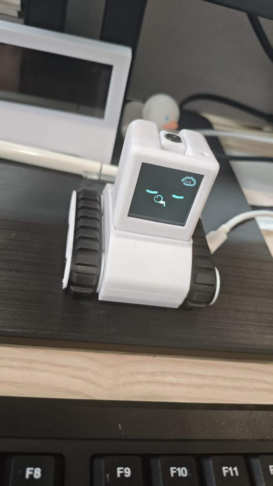

# Baby Tank 数值心情与昼夜状态系统设计

日期：2026-10-20
状态：**云端状态/记忆接口已部署、头部新版已刷入、Android 新版已安装；深夜边界仍缺跨夜实机验收。** 下方「实施进度」保留早期阶段记录，不能当作当前版本说明。

### 2026-10-21 离线时钟边界

用户接受头部在**持续通电**的前提下维持 23:00–06:00 日程；未确认板上有电池后备 RTC，因此不承诺完全断电后仍知道当前时间。头部 0.14.32 已按 `Asia/Shanghai` 实现每天重复的 23:00 锁定、06:00 解锁，不再依赖云端只下发七天的时间窗口。可信云端时间或物理 USB 校时后，离线运行使用单调计时；软件复位时尝试从 ESP32 RTC 系统时间恢复。2026-10-22 用户明确改为：完全断电重启且未联网校时时，时间未知也允许唤醒和交互，不把未知时间画成睡眠；一旦取得可信时间，若处于 23:00–06:00 且开关开启，立即按深夜锁规则停车并拦截新互动。此可用性选择意味着孩子可通过断电重启绕过深夜锁，不能把它宣传为不可绕过的家长控制。要同时保证断电后离线准时与不可绕过，仍需独立供电的 RTC 等硬件时间源。

纯函数测试覆盖 05:59/06:00、20:59/21:00、22:59/23:00、次日 06:00 及 30 天后；固件编译、应用分区刷写、USB 校时后日间解锁与软件复位后离线恢复均已通过。**尚未实测真实跨过 23:00 和次日 06:00 的硬件行为**，也未证明长时间运行的时钟漂移量。当前设备保存的 Wi-Fi 名称已失效，AI 联网能力仍须重新配网；这与本地日程是否运行是两回事。

### 2026-10-20 后续实现与产品调整

- App「成长记忆」不再要求每次进入时通过手机锁屏验证，设置与记录直接可见；首次仍需设备范围的一次性配对，云端会话仍可撤销，令牌仍由 Android Keystore 保护。这是用户明确选择的易用性取舍：**已解锁且已配对的手机持有人可查看孩子的询问记录**，不能将其宣传为家长身份验证。
- 首页遥控/互动卡片改为同一角色的透明背景扁平生成插画，使用实物的白色方头、青色表情、白色楔形机身与黑色履带，不再混用四轮车 3D 插画；设置入口使用线性图标。插画由内置 imagegen 生成，项目素材为 `android/app/src/main/res/drawable-nodpi/icon_home_drive_flat_generated.png` 与 `icon_home_play_flat_generated.png`。
- 头部已接入可信时钟与策略回执、离线事件队列和六个待机场景；云端与 Android 构建/自动测试通过。已核对日间设备回执，但 23:00–06:00 深夜锁的各入口、离线重启、像素场景的实体屏幕效果尚未实机完成验收；不能仅凭编译和白天日志宣称全部完成。

### 2026-10-20 实施进度（与目标设计分开）

- 云端新增 `state_engine.mjs`：八项需求数值、昼夜时段、离线最多 24 小时补算、确定性心情派生；云端 `character_state` 独立存储。`/api/device/v1/mood` 的长期标签及数值已改为从需求与时间派生，模型的逐句情绪只控制短时表情。头部会在空闲且联网时每 5 分钟读取这个 v1 兼容接口来更新待机心情和时间带，但仍未读取 v2 策略或执行像素场景。
- `GET /api/device/v2/state` 与 `POST /api/device/v2/state/events` 提供设备鉴权状态读/事件写；管理端 `/api/admin/character-state` 可查看、修改时区/深夜策略与人工写入事件。事件有 UUID 幂等、每小时限额和版本冲突校验。对话仅在明确夸奖或探索问句且完整回答后，异步记一条保守事件；没有新增模型请求。
- 云端 `approved_memories` 用加密正文保存人工批准的称呼/故事主题/游戏主题/共同活动；管理端与设备范围的家长接口均可列表、新增、删除。仅相关且有效的少量条目进入后续对话，撤销或替换后不再进入 prompt。**没有自动从对话提取孩子信息**。
- 独立的 `question_history` 默认关闭；管理端 `/api/admin/question-history` 可显式启用 1–30 天保留期、分页查看和删除。只归档成功完成的语音问答，正文加密，不存音频或照片；关闭归档会删除表内记录。SQLite WAL/系统备份中的旧密文不保证立刻物理擦除，部署前仍需备份保留与密钥轮换策略。
- 云端管理页可为指定设备生成 10 分钟、一次性家长配对码，配对后仅发放该设备范围内的 30 天可撤销会话；管理页可撤销该设备全部家长会话。App 的首页和设置页有「成长记忆」入口，手机安全锁屏验证后才能进入；令牌使用 Android Keystore 加密保存在本机，不保存管理员密码或设备令牌。家长可查看八项数值、人工增删长期记忆、显式开启/关闭询问记录及分页删除。**手机锁屏验证不等于独立确认法定监护人；若孩子知道锁屏密码，仍可能进入。**
- 当前深夜设置返回 `enforcement: "preview_only"`。头部已读取云端时间带来调整待机节奏，但尚未统一拦截语音、触摸、运动，因此设置为开也**不代表深夜锁已经生效**。App 不提供虚假的「已启用」拨钮。跨手机性格同步与像素场景均待后续实现；不能把本阶段说成完整上线。
- 生产云端部署前已备份源码与 SQLite；`/healthz`、匿名接口拒绝和数据库建表已检查。Android 编译、Lint 与单测通过，但未做手机实机验证；用户明确要求这次先不安装。
- 头部新增加密 BLE `baby-identity` 端点，仅回传云端令牌验证过的设备 ID，不回传设备令牌。App 在身份 ID 与家长配对 ID 一致、头部接受动作后，才把喂食、喝水、戳一戳、游戏完成事件写入对应设备；云端事件 ID 幂等、限频，失败会在互动页提示「数值未同步」。**这段 App 链路尚未安装/实测，不能视为已上线。**
- 头部已修复 BLE `PING` 保活重置空闲计时的问题，并刷入长期心情/时间带轮询版；实机串口出现 `internet verified`、`verified time band=midday` 和 `needs-derived idle mood refreshed`。开机约 324 秒仍有 `curious` 待机表情轮换，而非旧版的睡眠脸。日间可信时间带内改为正常→发呆，不再自动进入夜间睡眠；21:00–06:00 延用正常→无聊→睡眠但阈值放宽。时间带超过 15 分钟不刷新时回退旧节奏，这是离线降级，**不等于完整离线日程**。刷写只覆盖 `0x100000` 应用分区，未擦除 NVS。
- 身份由设备鉴权 `/api/device/v1/identity` 返回；没有联网或查询失败时 BLE 端点返回空 ID，App 不写成长事件。云端健康检查通过，匿名请求身份接口返回 401。由于本轮未安装新版 App，BLE 身份回报和互动数值变化尚未端到端验证。
- App「戳一戳」使用独立的 `poked` 事件，不与实体 `side_touch` 混为一类；云端已部署这一规则。互动来源仍由现有 SQLite 约束记为 `parent`（代表家长配对的 App 会话），未来若需区分 App 与家长后台，须做数据库迁移，不能只改代码中的来源字符串。

## 目标、边界与视觉参考

把角色的长期心情从「模型直接给情绪标签」改为「时间、互动和对话事件改变数值，确定性规则派生心情」。时间日程、对话/遥控占用、待机场景和屏幕表情是不同层，不能放进同一个互相覆盖的状态枚举。

本轮先设计状态系统。像素角色和场景画面最后制作，但保留实物参考照片，避免临时聊天附件失效：



- 仓库内稳定地址：`docs/assets/baby-tank-physical-reference-2026-10-20.jpg`
- 本机绝对地址：`/Users/kirito/StudioProjects/baby-tank/docs/assets/baby-tank-physical-reference-2026-10-20.jpg`
- 来源：用户在本会话提供的实物照片；原始临时附件名 `codex-clipboard-df431eaa-57b6-47b2-9e41-bfb23cddc6f5.jpg`，临时地址**不应**作为未来引用。
- 文件：JPEG，1279×2275，121797 字节；SHA-256 `ce5f5360947fd5af9a9d9a6185bc4f63a50c4b13cc1653d1608a71cc9287f255`。
- 视觉方向与当前实现：把照片里的这台宝宝坦克像素化，而不是画一辆泛用炮塔坦克。头部采用 120×120 逻辑像素、2× 最近邻绘制的白色方头／青色脸／楔形机身／双黑履带角色；做操、看书、积木、冒险、看云、整理六段屏幕故事已接入待机状态机。2026-10-20 又把角色由约 61×77 缩到 42×55 逻辑像素，保留实物轮廓，让书、杠铃、地图等前景动作成为主体；六个场景分别加入低饱和度的室内／户外背景。用户认为 12×12 的两字标题仍大且突兀，因此改为无底框、低对比度的 10×10「看书中…」式状态字。单段最长 1 小时。USB 本地调试口支持 `scene preview 0..5`，只预览画面约一分钟，不修改待机计时或驱动履带；真实互动可打断，深夜策略未取到可信时间时会拒绝，联网完成时间同步后已成功触发看书场景。画面可读性、美观度仍需用户实屏复核。

## 已核实的现状与需要纠正的前提

1. 改动前，`src/mood.mjs` 的长期 `valence/arousal/dominance` 会受到模型在回复里选择的 `emotion/intensity` 影响；现已在云端服务入口改为需求与时间派生，保留旧模块函数供旧测试/兼容逻辑参考，不再用它更新长期心情。
2. `firmware/head/main/face_controller.c` 只用设备开机后的空闲时长判定 `normal`、`bored`、`sleeping`：约 60 秒正常、接着 30 秒无聊、之后睡眠。它没有日程概念。
3. 在已检查的头部源码中未发现墙上时间/时区同步逻辑；不能直接假定固件知道当前是 21:00 或 23:00。
4. `android/.../BabyTankApp.kt` 中喂食、喝水和游戏主要向设备发送表情编号；手机显示「吃光/喝光」并不等于设备或云端数值已改变。
5. 改动前 BLE `baby-control` 的有效包（包括 PING）会调用 `baby_tank_face_note_activity()`，定时 PING 可能反复重置空闲计时；现已改为 PING 不计入真实互动。其他后台活动与对话忙闲的边界还需继续核对。
6. `app_main.c` 把 `sleeping` 同时用于 Wi-Fi 省电与云端梦境刷新。白天把睡眠换成做操/其他待机场景时，不能沿用这一耦合，否则会影响网络和电源策略。
7. 当前 `device_mood_events.source` 只接受 `speech/touch/vision`；App 和时间事件需要新结构或版本化迁移。

这些是源码事实，不是对新设计的已完成声明。以下时长、分数和阈值均为**首轮待校准参数**，不是硬件实测或儿童行为研究结论。

## 一、独立的状态层与优先级

| 层 | 示例 | 谁决定 | 是否持久化 |
| --- | --- | --- | --- |
| 时间与策略 `clock_policy` | 白天、夜晚、深夜锁、时间可信度、时区 | 可信时钟 + 家长设置 | 策略和时区持久化；当前时段派生 |
| 需求 `needs` | 饥饿、口渴、精力等 0–100 数值 | 规则引擎处理事件与经过时间 | 持久化 |
| 长期心情 `mood` | 平静、开心、好奇、兴奋、低落、困倦等 | **仅由需求和上下文派生** | 可缓存，但不是独立真相来源 |
| 前台占用 `owner` | 对话、TTS、触摸互动、遥控、视频、OTA | 实际运行任务/租约 | 短时运行态 |
| 空闲节奏 `idle_phase` | 正常、发呆、场景、夜间睡眠 | 距离上次有效互动的时间 + 时段 | 运行态；重启后不必恢复中途动画 |
| 表现 `presentation` | 眼睛、逐句表情、气泡、像素场景 | 当前层的优先级合成 | 不作为需求值持久化 |

优先级：**急停/硬件安全 > 深夜锁的入口门禁 > OTA/故障提示 > 手机遥控 > 对话与 TTS > 用户主动互动 > 自主待机场景 > 长期心情表情**。急停在任何时段都有效。深夜锁不只是盖一张睡觉脸，必须在语音、顶部触摸、侧边触摸、App 普通互动、AI 动作、摄像头触发等入口统一拦截。

`owner != none` 才算忙；后台心跳、BLE PING、云端拉状态、Wi-Fi 重连和日志上报**不算**用户互动，也不重置空闲计时。云端生成一句回复的临时表情不改变长期心情。对话的 15 秒继续聆听窗口也不等于整机的白天/夜间空闲状态。

## 二、数值模型

首版持久化 8 个独立数值，范围 0–100，初值是温和中性值；数值只是虚构角色的游戏参数，不表示真实生理或心理状态。

| 字段 | 高数值含义 | 提议初值 | 主要来源 |
| --- | --- | ---: | --- |
| `hunger` 饥饿 | 越高越想吃 | 20 | 时间慢增；App 喂食下降 |
| `thirst` 口渴 | 越高越想喝 | 20 | 时间慢增；App 喝水下降 |
| `energy` 精力 | 越高越清醒、有精神 | 70 | 时间与休息；对话影响很小 |
| `stamina` 体力 | 越高越适合活动 | 75 | 活动小幅消耗；休息恢复 |
| `joy` 快乐 | 越高越愉快 | 60 | 游戏、触摸、对话事件；缓慢回归基线 |
| `excitement` 兴奋 | 越高越活跃，但过高不一定更好 | 35 | 游戏/惊喜上升；安静时较快下降 |
| `bond` 陪伴感 | 越高越愿意互动 | 55 | 有效陪伴事件上升；时间缓慢回归 |
| `curiosity` 好奇心 | 越高越想探索/看书 | 60 | 提问、学习、场景事件 |

`fatigue` 疲倦、`spirit` 精神状态是**派生显示值**，不要再独立存储，否则它们可能和 `energy/stamina` 冲突。示例：`fatigue = clamp(100 - 0.65×energy - 0.35×stamina + 夜间节律修正)`；`spirit = clamp(0.60×energy + 0.25×joy + 0.15×excitement - 夜间节律修正)`。首轮可试 21:00–23:00 修正 10、23:00–06:00 修正 20；夜间修正只改变派生表现，不篡改白天累积的原始数值。

时间变化按最后更新时间与当前可信 UTC 时间**惰性结算**，不启动每分钟写数据库的定时器。演示参数：白天每小时 `hunger +1.5`、`thirst +2`、`energy -1`；安静待机让 `stamina` 恢复；兴奋以约 45–60 分钟的时间尺度回到基线。时间本身最多把饥饿/口渴推到温和上限（建议 65–70），不能让孩子因为未喂机器人而看到「濒危、病倒」或无法对话。夜间睡眠可缓慢恢复 `energy/stamina`。跨很久离线时分段计算并限制单次追赶时长，不能因错误时钟突然跳到极端值。

## 三、事件如何改变数值

事件必须是带 `event_id`、设备 ID、来源、事件类型、可信时间、规则版本和可选对话 trace ID 的**语义事件**。App/AI 只能提交事件类型，不能直接写分数或最终情绪。服务端校验、限频、去重，返回权威快照与事件回执。下面的增减是待校准起点：

| 事件 | 建议增减 | 重要约束 |
| --- | --- | --- |
| App 喂食成功 | `hunger -15`，`joy +1` | 设备确认接受后才结算；同一点击不能重复入账 |
| App 喝水成功 | `thirst -20` | 同上；饮品种类主要改变画面，不制造营养差异 |
| 游戏完成 | `joy +2`、`excitement +3`、`stamina -1` | 输赢主要影响短时表情，不把孩子输赢变成长期惩罚 |
| 合适的侧边轻触 | `bond +2`、`excitement +1` | 冷却与每小时上限；连续戳不无限刷值 |
| 对话中的夸奖/分享/安慰 | `joy +1..3`、`bond +1..2` | 后端白名单事件与上限；不额外开一次 LLM 请求 |
| 共同学习/好奇提问 | `curiosity +1..2` | 不因模型答错或 ASR 失败扣分 |
| 安静场景完整播完 | `joy/curiosity/excitement` 至多 ±1 | 自主事件每日限额；被打断不结算，不能靠待机刷满数值 |

AI 根据用户问题和**自身实际回答**提出 `kind=shared_discovery/comfort_received/praise_received/...` 等受限事件；后端用 ASR 文本、回复和上下文做基本一致性校验，最多一次/轮，分数由服务端表决定。不能把孩子说「我饿了」误判成机器人饿了；孩子表达难过时，机器人先帮助孩子，不能把自身心情变成对话主体。失败、空音频和诊断回合不产生心情事件。日志记录事件类别与前后值，不额外存储儿童原话。

## 四、由数值派生心情，而非 AI 写心情

先计算 `comfort`（快乐、陪伴感与饥饿/口渴的温和合成）、`activation`（兴奋与精力）和派生疲倦，再按固定优先级映射长期心情。首版候选公式：`comfort = clamp(round(0.60×joy + 0.25×bond + 0.15×(100-max(hunger,thirst))))`；`activation = clamp(round(0.70×excitement + 0.30×energy - 0.20×fatigue))`。`clamp` 把结果截到 0–100。这样饥饿/口渴有影响，但不会单独决定对话能力。建议首版只输出 `calm/happy/curious/excited/sleepy/low/annoyed` 等少量**稳定标签**，映射到现有表情白名单；`bored` 由空闲阶段覆盖呈现。不要为了凑满 24 种表情而让长期心情频繁跳动。

示例判定顺序：

1. `fatigue ≥ 72` 且不在忙时：困倦；但晚上睡眠属于状态模式，不是模型心情。
2. `comfort ≤ 35` 且 `activation ≥ 60`：轻微烦躁；其余 `comfort ≤ 35`：短暂低落。都不能产生责备孩子的话术。
3. `comfort ≥ 60` 且 `activation ≥ 66`：兴奋；否则 `comfort ≥ 68`：开心。
4. `curiosity ≥ 70` 且 `energy ≥ 35`：好奇；其余平静。

`bored` 优先由**空闲阶段**决定，而不是把「无聊」当作角色的永久心情。离开当前标签要越过进入阈值约 8 点，并至少稳定约 90 秒；明确互动可即时触发短时表情，但不能绕过长期心情的滞回。上述阈值只供模拟测试，需观察儿童实际使用后再调整。

模型在每句 TTS 中提出的表演情绪可继续作为**短时表情建议**，经过白名单、强度和时间限制；它不再进入 `advanceMood` 或直接写 `device_mood_state`。如果短时建议与安全/深夜锁冲突，设备忽略。人格配置影响说话风格，不修改需求数值公式。

## 五、时间日程与忙闲状态

设备时区为每台设备的家长设置，默认 `Asia/Shanghai`；统一保存 UTC 时间戳，用时区计算本地时段。06:00–21:00 是白天，21:00–06:00 是晚上。下表闲置阈值只是首版原型，必须可配置和可测试：

| 本地时段 | 有互动后的正常期 | 发呆/无聊期 | 更久闲置时 |
| --- | --- | --- | --- |
| 06:00–12:00 | 约 2 分钟，按数值心情展示 | 约 2–5 分钟，眼神走神与短想法 | 从做操、看书、搭积木、地图探险等场景池选一个 |
| 12:00–15:00 | 约 3 分钟 | 约 3–8 分钟 | 安静看书、看云、观察小花；不安排高兴奋做操 |
| 15:00–18:00 | 约 2 分钟 | 约 2–5 分钟 | 探险、球类、画画、做操等场景池 |
| 18:00–21:00 | 约 3 分钟 | 约 3–8 分钟 | 整理、看书、看云等平静场景 |
| 21:00–23:00 | 正常，约 2 分钟 | 无聊，约 2–5 分钟 | **睡眠**，不再播放白天做操 |
| 23:00–06:00，深夜开关关闭 | 延续夜间节奏，允许主动唤醒 | 无聊 | 睡眠 |
| 23:00–06:00，深夜开关开启 | — | — | **深夜锁**；拒绝新唤醒和普通互动 |

白天不再把「空闲超过 90 秒」等同于睡觉。场景播放器属于空闲层：单段像素场景最长循环展示 1 小时，场景完成后回到平静待机，最早约 15 分钟后才可再次选择，最近 2–3 个场景不重复，且受心情/精力筛选。唤醒、触摸、遥控、用户互动、时间带或安全策略变化可以立即中断场景，1 小时不是不可退出的锁屏。若云端时间带超过 15 分钟未刷新，当前固件会保守结束场景，因此断网时不保证播满 1 小时。发呆想法用固件安全短句池轮换，避免每次待机都请求云端。白天的「做操、看书、外出」均是**屏幕故事**；没有用户/AI 当前回合的明确动作授权，不驱动底盘，不自动开启摄像头。

若对话、遥控、视频、用户互动或安全提示开始，待机场景立即中断并让出屏幕；背景服务活动不重置闲置计时。App 退后台时发送的幂等 STOP 和「退出摄像头模式」属于清理命令，不应被计作互动；STOP 仍须实际停车。夜间睡眠与 Wi-Fi 省电、云端梦境刷新要解耦，避免状态名称改变后使网络行为意外改变。

夜间梦泡文字不应长期卡在云端缓存的一句“软绵绵”：优先展示当前已验证文案，再在设备端按分钟轮换五条已有字库里的温和短句。轮换只改变屏幕文字，不自动播放声音，不增加模型调用、网络请求、NVS 写入或第二份帧缓冲。

## 六、深夜睡眠开关的精确定义

- 开关默认关闭；只能由家长入口修改，配置按设备保存到云端和头部本地非易失存储，App 显示**设备确认值**而不是只显示本地拨钮。现有 App 尚无家长鉴权，这属于实施前必须补的产品边界。
- 开启后只在设备本地 **23:00–06:00** 生效：停止/拒绝新语音唤醒、顶部与侧边触摸反应、App 普通互动、AI 新动作、摄像头拍照和自主场景；显示安静睡眠画面，不主动播声音。到 06:00 自动解除锁，但不自动说话或开动履带。
- 跨过 23:00 时立即对正在执行的底盘动作发 STOP；已有 TTS 可在一个受限时间内自然收尾，之后不开始下一轮。停止命令、家长解锁/修改设置和必要的安全维护始终可用。手机遥控不能借 BLE 绕过深夜锁。
- 若已开启开关但重启后墙上时间不可信：优先用上次可信 UTC + 可用的连续计时估算，并向已配对手机或云端校时；仍未知时保守保持锁定，允许家长在 App 明确解锁。这样可能造成白天短暂不能唤醒，属于安全与可用性的权衡，必须在 App 提示，而不是默默假定白天。
- 深夜锁是交互策略，不代表切断网络/电源；不可把它直接等同于 `esp_wifi` 省电开关。

## 七、状态与数据接口设计

建议新增版本化的 `device_need_state`（八项数值、状态版本、最后结算 UTC）、`device_state_events`（唯一 `event_id`、来源、类型、规则版本、前后摘要、时间）和 `device_policy`（时区、深夜开关、更新时间）。保留旧 `device_mood_state/events` 作为迁移期兼容与历史记录；旧 PAD **不能反推**饥饿/体力，因此新数值从产品基线初始化，不伪造迁移历史。之后旧 mood 接口可输出派生投影，但不能继续由模型写入。

目标设备状态读接口可逐步增加：`schemaVersion, stateVersion, serverNowUtc, timezone, clockQuality, needs, derivedMood, idlePhase, foregroundOwner, nightLockActive, policy`；当前 v2 接口还没有完整提供时钟质量、前台占用和头部确认的深夜锁。写事件接口只接受白名单事件和事件 ID，重复事件返回同一回执，不再加分；父母设置接口要求配对/家长鉴权。首版 App 先经加密 BLE 确认头部动作及已验证设备 ID，再凭设备范围的家长会话直接写云端事件；断网时明确显示未同步，不假装完成。后续若要头部离线排队，可增加版本化 BLE 语义消息和头部云端同步，不复用当前 8 字节 `STOP/DRIVE/LIGHTS/PING` 控制包承载任意数值。

云端为权威记录，头部保留最近的紧凑快照与有限离线事件队列；断网时可本地计算并展示，重连后按事件 ID 幂等合并并采用服务端返回的版本。不要每帧写 NVS；需要明确快照写入频率、磨损与断电丢失窗口。内存上规则引擎只存八项数值、时间和少量队列，不增加摄像头/音频大缓冲，也不为每次对话增加额外 LLM 调用。

## 八、云端 + App 记忆辅助（新增设计）

### 当前能力与不能混淆的概念

`src/conversation_memory.mjs` 已把每台设备最近最多 8 轮对话加密保存，并且只读取过去 30 天的轮次，随后作为历史消息传入模型。管理 API 可以查看轮数或整台设备清空，但 App 没有记忆中心。这是**短期上下文**，不是可信、可编辑的长期记忆。旧记录的物理删除在保存下一轮对话时执行；若设备长时间不说话，读接口虽然过滤过期轮次，数据库里仍可能暂留旧行，需要独立清理任务。

建议区分四类，不把所有记录都塞进 prompt：

| 层 | 内容 | 默认处理 | 谁能查看/修改 |
| --- | --- | --- | --- |
| 本轮工作记忆 | 当前 ASR、看图与回复所需上下文 | 本轮结束即失效 | 不展示完整原始音频/图像 |
| 短期对话上下文 | 现有最近 8 轮 | 维持短期上限；家长可清空 | 家长查看摘要/轮数，必要时清空 |
| 长期事实/偏好 | 称呼、喜欢的故事类型、已明确分享的爱好、共同完成的活动 | **默认不自动保存**；家长添加或审核候选后才生效 | 家长在 App 的「记忆中心」管理 |
| 提醒事项 | 「明天提醒我带画笔」等未来任务 | 与角色记忆**分开建模**；需要家长确认时间、设备与通知方式 | 家长创建/编辑/取消；深夜不自发语音播报 |

长期记忆不等于情绪数值：`needs` 是确定性状态；记忆只为回答提供有限背景，并可产生经过规则校验的互动事件。情绪低落时不能为了「符合人设」捏造过去的共同经历。

### 长期记忆的录入、检索与遗忘

长期记忆是真正会被未来对话使用的**结构化事实/经历**，不能等同于整份问答历史。建议分三类：`profile`（经确认的称呼与兴趣）、`preference`（故事主题、喜欢/不喜欢的玩法）、`episode`（「上周一起读过恐龙故事」等有时间范围的共同经历）。`personality` 是机器人自身的配置，不是关于孩子的记忆；`question_history` 是家长可查的历史，不会自动进入未来 prompt。

第一阶段只允许家长在 App 手工建立 `nickname/preference/shared_activity` 等白名单记忆。第二阶段在成功对话结束后**异步**提取候选：只依据孩子明确说过的内容和可核验的本轮事件，附来源 trace、原句证据、类型、适用资料和建议到期日；提取不阻塞本轮 TTS。候选先经过敏感信息过滤、去重、与既有记忆的冲突检测。默认需要家长在 App 批准才生效；家长可另行选择「普通兴趣自动记住」模式，让非敏感、重复明确表达的偏好自动入库并在 App 可撤销，但姓名/住址/学校/健康/家庭关系等仍不得自动入库。模型不能把自己的猜测、照片推断、回答内容或未确认的 ASR 文本直接写成事实。用户说「我不喜欢恐龙了」应创建修订/撤销，而不是并存两条冲突记忆。

示例：孩子说「我最近喜欢恐龙故事」→ 候选 `type=preference, subject=story_theme, value=dinosaur`，附当轮来源；批准后下次问「讲个故事」时，云端检索到该条，AI 可以优先讲恐龙故事。孩子随后说「我现在更喜欢海洋」→ 生成**更新候选**；批准或符合家长自动规则后撤销旧偏好并写新偏好。不能仅凭一次「你喜欢恐龙吗？」的提问认定孩子喜欢恐龙。

云端可新增 `memory_items`：随机 ID、设备 ID、可选家庭成员资料 ID、类型、加密正文、受控标签、来源 trace、候选/已批准/已撤销状态、创建/到期时间与版本。记忆正文要尽可能写成短的原子事实，而不是长篇总结。每次对话只在同一云端进程的数据库中按类型、显式问题和最近更新时间取少量相关且已批准的条目，例如最多 3–5 条、总注入长度有限；**不额外发起一次 LLM 或向量检索请求来拖慢首声**。检索不到就正常回答，不编造「我记得」。原始音频、连续视频和普通摄像头照片不进入长期记忆库。

建议偏好与称呼由家长决定是否长期保留；日常活动类设较短到期时间（例如初版 30 天），过期后不注入模型。要支持单条更正、撤销、清空全部、导出以及「这次别记住」；孩子明确说「别记这个/忘掉刚才的事」时，本轮不生成候选，关联记忆**立即暂停检索**并提示家长确认永久删除或更正，不能在等待家长操作时继续引用。撤销后立即停止检索，缓存随版本失效。日志只写记忆 ID、类型、状态与来源，不记录明文正文。加密、密钥轮换、备份删除和实际保留期需在实现前明确。

### App 体验、多人共用与儿童隐私

App 增加家长入口「成长记忆」：入口放在**首页的宝宝状态卡**与**设置页**，两处进入同一页面；普通首页只显示非敏感的当前心情与状态，点入询问记录和长期记忆前须通过家长验证。现有 `CharacterScreen` 可以复用滑杆，但不能假装它已经是云端档案。

页面信息架构：

```text
首页「成长记忆」或 设置「成长记忆」
  ├─ 总览：当前心情、昼夜/忙闲状态、八项数值摘要、最近互动时间
  ├─ AI 性格：好奇心/亲近感/话语量、当前生效版本、同步状态
  ├─ 孩子的询问：按时间倒序的问题记录；点开可看 AI 当时的回答
  ├─ 长期记忆：已记住、待家长确认、已过期；修改/撤销/删除
  └─ 管理：长期记忆开关、记录保留期、导出与一键遗忘
```

「孩子的询问」一条记录显示本地时间、ASR 识别出的提问文本、是否成功回答；详情才展示 AI 回答，以及是否曾拍照/执行动作的**标记**，默认不保存或展示音频、照片本体。识别错误时家长可标记「识别有误」并选择删除；这条更正不自动篡改已经说出的历史回答。列表支持按日期分页、单条删除与清空。若未确认说话人身份，标题必须写「这台设备的询问记录」，不能擅自标注是哪个孩子提出的。

现有 `conversation_turns` 每台设备只保留最近 **8 轮**，保存下一轮时裁掉更旧的行；其管理 API 只返回轮数/日期范围或整机清空，不足以实现上述列表。若家长启用询问记录，需要**独立的、加密的问答历史表**，与模型短期上下文分开：建议默认仅保留成功识别且完成回答的记录、按日分页、最多保留 30 天或家长选择更短期限；未启用则不额外归档。问答历史不等于「AI 已记住的事实」，不能自动注入后续 prompt。旧的 8 轮存储也不应偷偷扩成长期日志。

AI 性格当前在 App `SharedPreferences` 中保存草稿，经加密 BLE 写入头部非易失存储，头部在对话请求中把三个数值传给云端；云端**没有独立的权威性格档案**。未来跨手机页面应新增按设备版本化的性格配置，App 展示「本机草稿 / 设备已生效 / 云端已同步」三个状态，编辑后以设备回执和云端版本确认成功。旧手机重新打开不能用过期本地滑杆覆盖新手机已经设置的性格。固定安全人格与可调三个参数必须分开显示，孩子的询问记录也不能未经家长操作就改变性格配置。

云端接口建议使用**面向家长、按设备授权**的查询与写入能力：状态/性格摘要、获批记忆分页、问答历史分页、单条删除、清空、审核候选及性格版本更新。现有 `/api/admin/conversation-memory` 是运营管理接口，不应把管理员会话或设备令牌直接放进手机 App。需要建立设备归属与家长登录/解锁、最小权限令牌、审计和撤销流程；在这套鉴权就绪前，不能向 App 暴露孩子的询问文本。敏感问答正文仅云端按权限解密并传输，不进普通遥测；App 默认不落盘缓存正文，离线时显示「记录暂不可查看」，而不是展示陈旧或跨账号内容。

App 还应覆盖空状态、加载失败、设备未联网、手机未获家长授权、多手机同步冲突和删除确认。首页入口可以始终可见，但未经验证只能显示中性引导，不能预览孩子的提问。孩子侧只在自然提问时用经批准的记忆，不显示后台数据库概念，也不要求孩子反复提供私人信息。

当前短期记忆按**设备**归属，代码未提供说话人身份识别。因此，多个孩子共用设备时，默认只能使用家庭共享且无敏感内容的记忆。若要记「某个孩子」的个人偏好，必须先由家长在 App 明确选中资料，并设计可靠的会话切换；**不能靠 AI 猜测是谁在说话**。住址、学校、联系方式、健康问题、家庭矛盾、精确行踪和面部身份都不应被自动提议为长期记忆。儿童安全回答优先于角色连贯性；机器人不能用记忆制造依赖、保密要求或愧疚感。

提醒事项还涉及通知权限、手机不在附近、设备断网、跨时区和深夜锁，不能只把一句话放进长期记忆就称为「提醒已设置」。首版可由家长 App 发手机本地通知；如要机器人准时播报，需另设计可靠投递与深夜静音规则。此能力属于单独阶段，不能默认为现有记忆链路已经支持。

### 记忆验收

批准前绝不进入 prompt；撤销后下一轮不再出现；重复候选不重复创建；相互矛盾的偏好只有最新获批版本生效；空白/失败 ASR、照片中的推测和模型编造不入库；同一设备的不同家庭成员资料不串用；断网时机器人能正常对话但明确不假装记得云端未同步的事情；检索不增加新的模型调用，并记录对首声延迟的实际影响。App 验收还包括：未获家长授权时不能查看问答正文；性格回显与头部生效值一致；新手机登录不会覆盖旧手机的较新配置；分页记录只显示获准设备且删除后无法继续查询；询问记录归档关闭时不新增历史记录。

## 九、实施顺序与验收

1. **纯规则阶段**：抽出可注入 UTC/时区的确定性状态函数，模拟 24 小时、离线补算、事件重试和阈值滞回；不改当前设备行为。
2. **云端与数据库阶段**：加版本化状态、事件幂等和家长策略；新旧 mood 只读对照一段时间，检查模型情绪不再写长期心情。
3. **App 阶段**：喂食/喝水/游戏发送语义事件并显示回执；设置页增加家长深夜开关、时区和数值说明，不以动画播放成功冒充数值入账。随后增加家长「记忆中心」，首版只允许手工写入/更正/删除获批长期记忆。
4. **头部阶段**：可靠时间源、入口门禁、优先级、空闲节奏、断网快照；移除 BLE PING 唤醒效应，并把睡眠显示与 Wi-Fi 省电解耦。
5. **记忆扩展阶段**：在家长手工记忆稳定后，再评估异步候选提取、多人资料和提醒事项；不占用语音首声关键路径。
6. **画面阶段（最后）**：已根据本记录照片制作像素版角色和六个代码绘制场景；不增加第二份全屏帧缓冲，也不让场景驱动电机或摄像头。完成度以实机可辨认和触摸／语音立即中断为准，不能只凭编译或云端 `scene_completed` 事件认定视觉验收通过。

最低验收用例：20:59→21:00、22:59→23:00、05:59→06:00；时区修改与夏令时地区；断网/重启/时钟未知；App 重复点击或 BLE 重发；对话跨 23:00；锁定期间语音、触摸、摄像头、App、AI 行走均被拒绝；任何时段 STOP 生效；单次对话无新增 LLM 请求；场景和网络心跳不会误重置空闲计时。实机测量还需记录剩余内部 RAM/PSRAM、TTS 首声延迟、屏幕帧时、电池续航和异常重启。

## 未确定的问题与风险

- 家长入口如何鉴权、多个手机同时修改策略如何解决冲突，现有产品尚无最终实现。
- 多个孩子共用设备时，个人记忆归属与会话切换尚无可靠身份依据；默认只允许无敏感内容的家庭共享记忆。
- 不同家庭的时区与设备长期离线时间可信度需要产品决策；默认 `Asia/Shanghai` 只适合当前使用环境，不是全球通用假设。
- 场景的时间阈值与数值增减是设计值，需要小范围使用和实机电源/内存测试，不能宣称已验证。
- 2026-10-20 晚间复核：手机退后台的两次 BLE STOP 均返回 `UNAVAILABLE`；头部 USB 上单独发送安全 `motor stop` 也得到 `ESP_ERR_TIMEOUT`（底盘 UART 无回显）。没有发送行走命令。当前不能据此宣称底盘停车回执已通过，需先核对底盘供电/连线，再在架空条件下重新验收。
- 所谓「饥饿、疲倦、难过」应明确是虚构宠物状态，不能让孩子感觉必须照顾设备才会得到正常回答；状态不得削弱事实正确性、儿童安全答复或急停能力。
- 回滚方案：保持现有 `mood`/表情 API 的只读兼容开关；遇到状态迁移错误时停用新事件写入并回到现有待机逻辑，不清空用户原数据。
